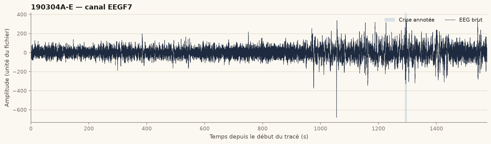
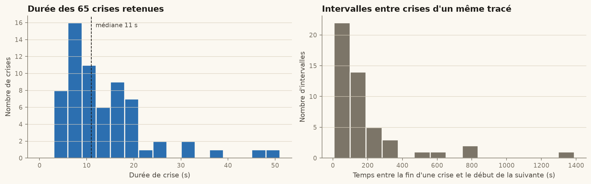
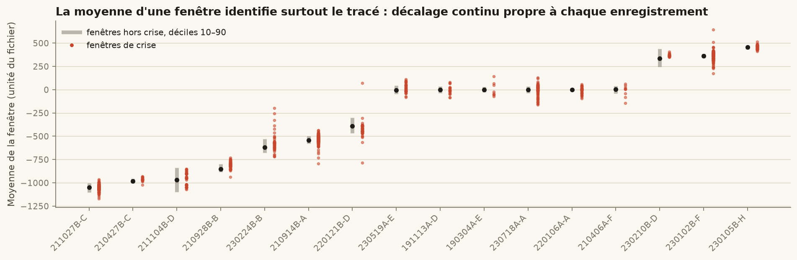
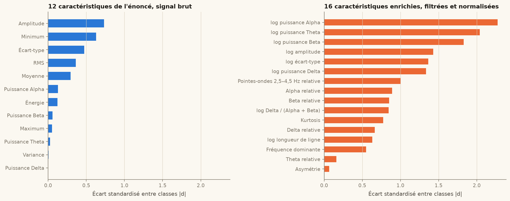
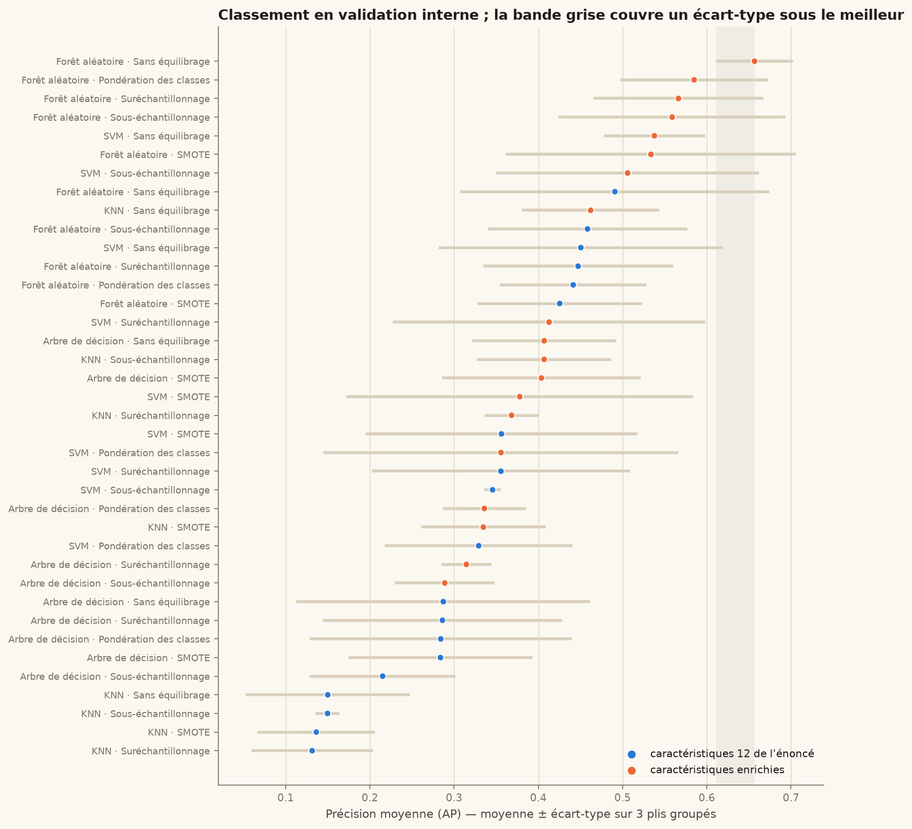
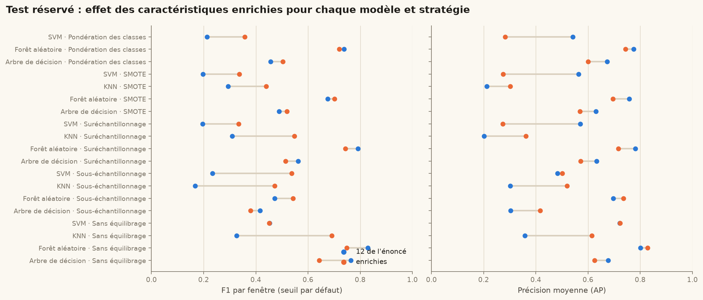
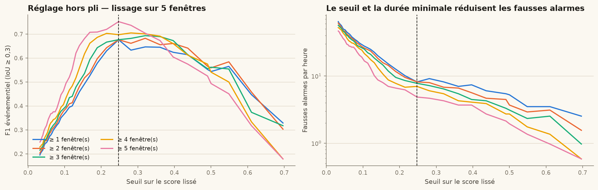
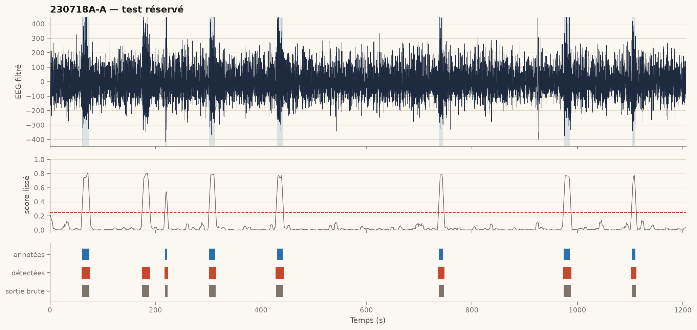
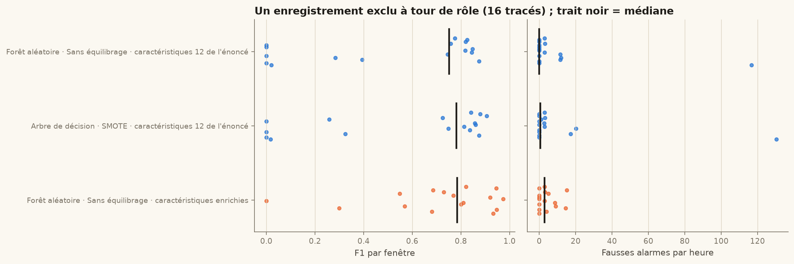

# Détection automatique des crises d'absence à partir de l'EEG

Mini-projet de data mining — rapport final, 11/10/2026.
Tous les nombres de ce rapport sont produits par l'exécution du notebook `notebooks/mini_projet_eeg_final.ipynb` ; aucun n'est saisi à la main.

## Résumé

Sur 16 enregistrements EEG annotés (65 crises d'absence), nous classons des fenêtres de 2 s puis reconstruisons des épisodes. Avec les 12 caractéristiques de l'énoncé, le meilleur modèle en validation interne n'atteint qu'une précision moyenne (AP) de 0,49. Deux défauts l'expliquent : un décalage continu propre à chaque tracé, qui fait des statistiques d'amplitude brutes des identifiants d'enregistrement, et des puissances spectrales à queue très lourde. Un filtrage passe-haut à 0,5 Hz, des puissances logarithmiques et relatives et une normalisation robuste par enregistrement portent l'AP interne à **0,66**. Un post-traitement (lissage, seuil, durée minimale), réglé sur des prédictions hors pli, ramène les fausses alarmes sur le test réservé de **134 à 1,5 par heure**, avec 14 crises retrouvées sur 17. En validation « un enregistrement exclu », le système retrouve 85 % des crises avec 4,1 fausses alarmes par heure.

## Introduction et problématique

L'absence typique est une crise généralisée brève, de quelques secondes à quelques dizaines de secondes, avec une rupture du contact et, à l'EEG, des pointes-ondes bilatérales et synchrones autour de 3 Hz [1, 2]. Ces crises sont fréquentes et peu visibles ; les compter sur un long tracé est fastidieux. La question posée est la suivante : **peut-on repérer automatiquement ces épisodes sur des enregistrements jamais vus, avec assez peu de fausses alarmes pour qu'une relecture reste utile ?** Nous comparons quatre classifieurs (arbre de décision, forêt aléatoire, KNN, SVM) et plusieurs façons de traiter le déséquilibre, puis nous évaluons au niveau des fenêtres et au niveau des épisodes.

## Données

Le classeur `Annotations MAJ.xlsx` donne, pour chaque tracé, l'heure de début de l'enregistrement et les heures de début et de fin de chaque crise. Elles sont converties en secondes depuis le début du tracé : `(DebCE − DebutTrace) × 86 400`. Pour `190304A-E`, la crise de 10:35:06 à 10:35:13 sur un tracé commencé à 10:13:35 donne [1 291 s ; 1 298 s].

Les fichiers `.mat` contiennent des objets MATLAB `timetable` que `scipy.io` ne lit pas. Les signaux ont été extraits par un lecteur dédié, puis **comparés valeur par valeur** aux cellules numériques des fichiers d'origine (échantillons, noms des canaux, temps). La fréquence d'échantillonnage, mesurée sur l'axe temporel, vaut 256 Hz pour tous les tracés.

Trois enregistrements sont exclus : `230406B-A` et `230515B-G`, présents deux fois avec des annotations contradictoires, et `210504B-C`, dont une annotation dépasse la durée du signal (21 608 s pour un tracé de 3 121 s). `210914B-A` déclare 6 crises mais en décrit 11 ; les 11 paires sont conservées. La cohorte finale compte **16 enregistrements, 65 crises et 23,444 fenêtres**, dont 940 positives (4,0 %). Les crises durent de 3 à 49 s (médiane 11 s) ; 187 des fenêtres positives viennent d'un seul tracé, `210914B-A`.

## Méthodologie

**Segmentation et étiquetage.** Un seul canal, F7, présent dans tous les tracés et choisi avant tout apprentissage : les absences étant généralisées, la décharge est visible sur l'ensemble du scalp. Fenêtres de 2 s (512 échantillons) avec un recouvrement de 50 % ; une fenêtre est « crise » si au moins la moitié de ses échantillons tombe dans un intervalle annoté [début, fin].

**Caractéristiques de l'énoncé.** Moyenne, écart-type, variance, minimum, maximum, amplitude, RMS, énergie, et puissances FFT unilatérales en Delta [0,5 ; 4[, Theta [4 ; 8[, Alpha [8 ; 13[ et Beta [13 ; 30[ Hz.

**Pourquoi les enrichir.** L'analyse exploratoire montre que la moyenne d'une fenêtre varie de plusieurs centaines d'unités d'un tracé à l'autre (figure 3) : le signal n'est pas centré et chaque enregistrement a son propre décalage continu. La moyenne, le minimum et le maximum décrivent donc surtout *quel* tracé on regarde. Ce n'est pas ce que l'on veut apprendre, et le modèle ne peut pas le généraliser à un nouveau tracé. À l'inverse, la puissance Delta, où devrait apparaître la décharge à 3 Hz, a un écart standardisé entre classes de 0,001 : ses valeurs extrêmes (artefacts) écrasent la différence. Nous avons donc ajouté un second jeu de 16 caractéristiques, calculé sur le signal filtré en passe-haut à 0,5 Hz (Butterworth d'ordre 4, phase nulle) : logarithmes de l'écart-type, de l'amplitude, de la longueur de ligne [7] et des quatre puissances ; puissances relatives ; part de la bande 2,5–4,5 Hz (pointes-ondes) ; rapport Delta / (Alpha + Beta) ; asymétrie, kurtosis et fréquence dominante. Chaque caractéristique est centrée et réduite par la médiane et l'écart interquartile **de son propre enregistrement**, sans utiliser les étiquettes, puis bornée à ±10. La meilleure caractéristique passe d'un écart standardisé de 0,73 (Amplitude) à 2,27 (log puissance Alpha) (figure 4).

**Séparation des données.** Les fenêtres d'un même tracé se recouvrent et se ressemblent ; une séparation au niveau des fenêtres ferait fuir l'information du test vers l'apprentissage [8]. Les données sont donc séparées **par enregistrement** : 4 tracés (4,925 fenêtres, 21 %) forment le test réservé et 12 tracés l'apprentissage. Le découpage est choisi parmi 256 tirages groupés uniquement pour approcher 80/20 et la proportion de crises, sans regarder aucun score.

**Modèles et déséquilibre.** Arbre de décision (profondeur 8), forêt aléatoire (200 arbres) [5], KNN (5 voisins pondérés par la distance), SVM à noyau RBF (C = 1), hyperparamètres fixés à l'avance. Cinq stratégies : sans équilibrage, sous-échantillonnage aléatoire, suréchantillonnage par duplication, SMOTE [3], et pondération des classes (`class_weight="balanced"`, hors KNN). Normalisation et rééchantillonnage sont placés dans un pipeline `imbalanced-learn` [6] et ne voient jamais les fenêtres évaluées. Au total : 2 jeux × 19 couples = **38 configurations**.

**Sélection.** Trois plis stratifiés et groupés par enregistrement, à l'intérieur de l'apprentissage. Le critère, fixé avant de lancer les calculs, est la **précision moyenne (AP)** moyenne sur les plis. Elle résume toute la courbe précision-rappel et ne dépend pas d'un seuil arbitraire, ce qui convient à une classe positive à 4 % [9].

**Des fenêtres aux épisodes.** Les fenêtres positives qui se touchent sont fusionnées en épisodes. Un épisode prédit est apparié à une crise annotée si leur IoU (intersection sur union) atteint 0,3, avec un appariement un à un. Trois réglages transforment les scores en épisodes : un lissage sur 1, 3 ou 5 fenêtres, un seuil, et une durée minimale de 1 à 5 fenêtres consécutives. Ils sont choisis pour maximiser le F1 événementiel sur les **prédictions hors pli de l'apprentissage**, puis figés avant l'évaluation sur le test.

**Validation « un enregistrement exclu » (LORO).** Le test réservé ne compte que 4 tracés. Pour estimer la variabilité, la configuration retenue et trois références fixées à l'avance sont réévaluées en excluant chaque tracé à tour de rôle (16 fois). Le post-traitement est alors réglé, à chaque itération, sur les prédictions hors pli des 15 autres tracés.

## Résultats

### Validation interne

Le meilleur résultat en validation interne est **Forêt aléatoire · Sans équilibrage · caractéristiques enrichies** : AP = 0,657 ± 0,045. Aucune autre configuration ne se trouve à moins d'un écart-type de ce score. Avec les seules caractéristiques de l'énoncé, la meilleure AP est 0,491. Les 4 premières places reviennent à la forêt aléatoire sur caractéristiques enrichies, quelle que soit la stratégie d'équilibrage : le choix des caractéristiques compte plus que celui de la stratégie.

L'ancien critère (F1 moyen au seuil par défaut, 12 caractéristiques) désignait forêt aléatoire · pondération des classes, alors que 4 configurations tenaient en 0,02 point de F1 avec des écarts-types de 0,11 à 0,18 : ce classement relevait du hasard des plis.

### Test réservé, niveau fenêtre

La baseline « toujours hors crise » obtient une accuracy de 0,957 avec un rappel nul : l'accuracy seule ne dit rien ici. Le tableau 1 donne les 16 configurations demandées par l'énoncé (12 caractéristiques, seuil par défaut).

Tableau 1 — Test réservé, 12 caractéristiques de l'énoncé.

| Stratégie | Modèle | Accuracy | Précision | Rappel | F1 | AP | TP | FP | FN | TN |
| --- | --- | --- | --- | --- | --- | --- | --- | --- | --- | --- |
| Sans équilibrage | Arbre de décision | 0.978 | 0.722 | 0.810 | 0.763 | 0.677 | 171 | 66 | 40 | 4648 |
| Sans équilibrage | Forêt aléatoire | 0.986 | 0.843 | 0.815 | 0.829 | 0.801 | 172 | 32 | 39 | 4682 |
| Sans équilibrage | KNN | 0.959 | 0.551 | 0.232 | 0.327 | 0.358 | 49 | 40 | 162 | 4674 |
| Sans équilibrage | SVM | 0.969 | 0.889 | 0.303 | 0.452 | 0.721 | 64 | 8 | 147 | 4706 |
| Sous-échantillonnage | Arbre de décision | 0.895 | 0.273 | 0.872 | 0.416 | 0.303 | 184 | 489 | 27 | 4225 |
| Sous-échantillonnage | Forêt aléatoire | 0.915 | 0.321 | 0.891 | 0.472 | 0.697 | 188 | 398 | 23 | 4316 |
| Sous-échantillonnage | KNN | 0.625 | 0.093 | 0.882 | 0.168 | 0.302 | 186 | 1821 | 25 | 2893 |
| Sous-échantillonnage | SVM | 0.755 | 0.135 | 0.877 | 0.234 | 0.483 | 185 | 1183 | 26 | 3531 |
| Suréchantillonnage | Arbre de décision | 0.942 | 0.416 | 0.863 | 0.562 | 0.633 | 182 | 255 | 29 | 4459 |
| Suréchantillonnage | Forêt aléatoire | 0.982 | 0.791 | 0.791 | 0.791 | 0.781 | 167 | 44 | 44 | 4670 |
| Suréchantillonnage | KNN | 0.895 | 0.216 | 0.550 | 0.310 | 0.202 | 116 | 422 | 95 | 4292 |
| Suréchantillonnage | SVM | 0.681 | 0.110 | 0.905 | 0.196 | 0.570 | 191 | 1549 | 20 | 3165 |
| SMOTE | Arbre de décision | 0.924 | 0.344 | 0.853 | 0.490 | 0.630 | 180 | 344 | 31 | 4370 |
| SMOTE | Forêt aléatoire | 0.966 | 0.568 | 0.834 | 0.676 | 0.758 | 176 | 134 | 35 | 4580 |
| SMOTE | KNN | 0.869 | 0.191 | 0.640 | 0.294 | 0.213 | 135 | 571 | 76 | 4143 |
| SMOTE | SVM | 0.687 | 0.111 | 0.900 | 0.198 | 0.564 | 190 | 1519 | 21 | 3195 |

Tableau 2 — Test réservé, caractéristiques enrichies (les cinq stratégies).

| Stratégie | Modèle | Accuracy | Précision | Rappel | F1 | AP | TP | FP | FN | TN |
| --- | --- | --- | --- | --- | --- | --- | --- | --- | --- | --- |
| Sans équilibrage | Arbre de décision | 0.973 | 0.741 | 0.569 | 0.643 | 0.625 | 120 | 42 | 91 | 4672 |
| Sans équilibrage | Forêt aléatoire | 0.981 | 0.884 | 0.649 | 0.749 | 0.828 | 137 | 18 | 74 | 4696 |
| Sans équilibrage | KNN | 0.976 | 0.780 | 0.621 | 0.691 | 0.614 | 131 | 37 | 80 | 4677 |
| Sans équilibrage | SVM | 0.968 | 0.844 | 0.308 | 0.451 | 0.723 | 65 | 12 | 146 | 4702 |
| Sous-échantillonnage | Arbre de décision | 0.894 | 0.254 | 0.758 | 0.380 | 0.417 | 160 | 471 | 51 | 4243 |
| Sous-échantillonnage | Forêt aléatoire | 0.942 | 0.410 | 0.806 | 0.543 | 0.736 | 170 | 245 | 41 | 4469 |
| Sous-échantillonnage | KNN | 0.912 | 0.318 | 0.924 | 0.473 | 0.520 | 195 | 419 | 16 | 4295 |
| Sous-échantillonnage | SVM | 0.941 | 0.405 | 0.796 | 0.537 | 0.502 | 168 | 247 | 43 | 4467 |
| Suréchantillonnage | Arbre de décision | 0.940 | 0.394 | 0.739 | 0.514 | 0.572 | 156 | 240 | 55 | 4474 |
| Suréchantillonnage | Forêt aléatoire | 0.980 | 0.822 | 0.678 | 0.743 | 0.716 | 143 | 31 | 68 | 4683 |
| Suréchantillonnage | KNN | 0.951 | 0.451 | 0.697 | 0.547 | 0.361 | 147 | 179 | 64 | 4535 |
| Suréchantillonnage | SVM | 0.935 | 0.299 | 0.379 | 0.334 | 0.273 | 80 | 188 | 131 | 4526 |
| SMOTE | Arbre de décision | 0.946 | 0.418 | 0.687 | 0.520 | 0.569 | 145 | 202 | 66 | 4512 |
| SMOTE | Forêt aléatoire | 0.976 | 0.745 | 0.664 | 0.702 | 0.695 | 140 | 48 | 71 | 4666 |
| SMOTE | KNN | 0.923 | 0.320 | 0.706 | 0.440 | 0.302 | 149 | 317 | 62 | 4397 |
| SMOTE | SVM | 0.937 | 0.308 | 0.370 | 0.336 | 0.275 | 78 | 175 | 133 | 4539 |
| Pondération des classes | Arbre de décision | 0.937 | 0.381 | 0.744 | 0.504 | 0.600 | 157 | 255 | 54 | 4459 |
| Pondération des classes | Forêt aléatoire | 0.977 | 0.749 | 0.692 | 0.719 | 0.744 | 146 | 49 | 65 | 4665 |
| Pondération des classes | SVM | 0.939 | 0.327 | 0.393 | 0.357 | 0.282 | 83 | 171 | 128 | 4543 |

Le sous-échantillonnage et le suréchantillonnage échangent de la précision contre du rappel ; la pondération des classes déplace le compromis dans le même sens, plus modérément. Pour la forêt aléatoire, aucune stratégie ne dépasse le F1 obtenu sans équilibrage, avec l'un ou l'autre jeu. Au seuil par défaut et sur ces quatre tracés, le jeu enrichi n'améliore pas tout : il transforme le KNN (F1 0,33 → 0,69) et élève l'AP de la forêt (0,80 → 0,83), mais la forêt sur les 12 caractéristiques garde le meilleur F1 brut (0,83 contre 0,75), et les SVM suréchantillonnés se dégradent. Quatre tracés ne suffisent pas à départager ; la validation « un enregistrement exclu » tranche (tableau 5).

### Test réservé, niveau épisode

Tableau 3 — Configuration retenue, avant et après post-traitement (lissage 5, seuil 0,248, au moins 5 fenêtres).

| Données | Sortie | Précision fen. | Rappel fen. | F1 fen. | Crises retrouvées | Crises manquées | Fausses alarmes | Rappel év. | Précision év. | Fausses alarmes / h |
| --- | --- | --- | --- | --- | --- | --- | --- | --- | --- | --- |
| Validation interne | Sortie brute | 0.66 | 0.43 | 0.52 | 35 | 13 | 84 | 0.73 | 0.29 | 16.32 |
| Validation interne | Post-traitement | 0.64 | 0.75 | 0.69 | 44 | 4 | 25 | 0.92 | 0.64 | 4.86 |
| Test réservé | Sortie brute | 0.88 | 0.65 | 0.75 | 12 | 5 | 7 | 0.71 | 0.63 | 5.11 |
| Test réservé | Post-traitement | 0.84 | 0.83 | 0.84 | 14 | 3 | 2 | 0.82 | 0.88 | 1.46 |

Le post-traitement fait passer les fausses alarmes de 5,1 à **1,5 par heure** sur 82 minutes de test, et le F1 par fenêtre de 0,749 à 0,838. À titre de comparaison, l'ancien choix (arbre de décision + SMOTE, sortie brute) produisait 184 fausses alarmes sur le même test, soit 134 par heure.

Tableau 4 — Détail par enregistrement de test.

| Enregistrement | Crises annotées | Retrouvées | Manquées | Fausses alarmes | Fausses alarmes / h |
| --- | --- | --- | --- | --- | --- |
| 211104B-D | 5 | 2 | 3 | 1 | 2.98 |
| 220106A-A | 2 | 2 | 0 | 0 | 0.00 |
| 220121B-D | 3 | 3 | 0 | 0 | 0.00 |
| 230718A-A | 7 | 7 | 0 | 1 | 2.99 |

### Validation « un enregistrement exclu »

Tableau 5 — LORO sur les 16 enregistrements.

| Configuration | Sortie | F1 fen. médiane | F1 fen. Q1–Q3 | F1 fen. poolé | Rappel év. | Précision év. | Fausses alarmes / h |
| --- | --- | --- | --- | --- | --- | --- | --- |
| Forêt aléatoire · Sans équilibrage · caractéristiques enrichies | Sortie brute | 0.61 | 0.34–0.77 | 0.58 | 0.72 | 0.37 | 12.12 |
| Forêt aléatoire · Sans équilibrage · caractéristiques enrichies | Post-traitement | 0.78 | 0.65–0.92 | 0.70 | 0.85 | 0.67 | 4.14 |
| Arbre de décision · SMOTE · caractéristiques 12 de l'énoncé | Sortie brute | 0.49 | 0.31–0.58 | 0.35 | 0.89 | 0.08 | 101.43 |
| Arbre de décision · SMOTE · caractéristiques 12 de l'énoncé | Post-traitement | 0.78 | 0.20–0.86 | 0.36 | 0.57 | 0.33 | 11.51 |
| Forêt aléatoire · Sans équilibrage · caractéristiques 12 de l'énoncé | Sortie brute | 0.72 | 0.40–0.86 | 0.47 | 0.82 | 0.21 | 29.92 |
| Forêt aléatoire · Sans équilibrage · caractéristiques 12 de l'énoncé | Post-traitement | 0.75 | 0.02–0.82 | 0.38 | 0.54 | 0.35 | 10.13 |

## Discussion

**La qualité des caractéristiques compte plus que l'équilibrage.** Les stratégies de rééchantillonnage déplacent le compromis précision/rappel, mais aucune n'apporte d'information nouvelle. Retirer le décalage continu et passer en échelle logarithmique change en revanche ce que le modèle peut apprendre : l'AP interne passe de 0,49 à 0,66. Sur les 16 tracés en LORO, à modèle et post-traitement identiques (forêt sans équilibrage), le jeu enrichi retrouve 85 % des crises contre 54 %, avec 4,1 fausses alarmes par heure contre 10,1. Avec les 12 caractéristiques, le premier quartile du F1 par tracé tombe à 0,02 : sur certains enregistrements, le modèle ne détecte presque rien, ce qui est cohérent avec un apprentissage de l'identité du tracé plutôt que de la crise.

**L'évaluation par épisode est celle qui compte.** Un F1 par fenêtre élevé peut cacher de nombreuses détections isolées d'une ou deux fenêtres. Or la crise annotée la plus courte dure 3 s et la médiane est de 11 s. Exiger une suite de fenêtres et lisser le score supprime l'essentiel de ces détections parasites. La durée minimale retenue, 5 fenêtres, correspond à environ 6 s de signal et se trouve à la borne de la grille fixée à l'avance. Les 3 crises manquées sur le test (6 à 8 s) appartiennent à `211104B-D`, alors qu'une crise de 4 s est retrouvée ailleurs : les omissions tiennent surtout au tracé, dont les scores restent bas, plus qu'à la durée des crises.

**Le test réservé est optimiste.** Sur les 4 tracés de test, le F1 par fenêtre (0,84) dépasse le F1 poolé sur les 16 tracés en LORO (0,70) ; d'un tracé à l'autre, il varie du simple au double (quartiles 0,65–0,92, médiane 0,78). Ce sont les chiffres LORO qu'il faut retenir.

## Conclusion

Une chaîne simple (un canal, des fenêtres de 2 s, une forêt aléatoire) suffit à retrouver la majorité des crises d'absence de cette cohorte avec quelques fausses alarmes par heure, à trois conditions : retirer le décalage continu, utiliser des caractéristiques indépendantes de l'échelle de chaque tracé, et raisonner en épisodes plutôt qu'en fenêtres. L'équilibrage des classes, au cœur de l'énoncé, a un effet secondaire par rapport à ces trois choix.

## Limites et perspectives

- **Effectif.** 16 enregistrements, sans identifiant patient fiable : deux tracés peuvent venir du même enfant, auquel cas la séparation par enregistrement ne garantit pas une séparation par patient.
- **Annotations.** Trois tracés exclus pour des annotations incohérentes ; les bornes annotées n'ont pas été relues par un second expert.
- **Un seul canal.** F7 est un choix fixé à l'avance ; un montage multicanal ou la moyenne de plusieurs dérivations rendraient la détection plus robuste aux artefacts locaux.
- **Normalisation par enregistrement.** Elle suppose un tracé assez long, dominé par l'activité de fond ; sur un extrait court, riche en crises, la médiane serait biaisée.
- **Hyperparamètres.** Fixés, non optimisés ; la grille de post-traitement s'arrête à 5 fenêtres, borne atteinte par le réglage retenu.
- **Perspectives.** Une validation sur une cohorte externe ou sur une base publique comme CHB-MIT [4], des modèles qui utilisent le contexte temporel (fenêtres voisines) et l'ajout de canaux.

## Bibliographie

1. Fisher R. S. et al. (2017). Operational classification of seizure types by the International League Against Epilepsy. *Epilepsia*, 58(4), 522–530.
2. Crunelli V., Leresche N. (2002). Childhood absence epilepsy: genes, channels, neurons and networks. *Nature Reviews Neuroscience*, 3(5), 371–382.
3. Chawla N. V., Bowyer K. W., Hall L. O., Kegelmeyer W. P. (2002). SMOTE: Synthetic Minority Over-sampling Technique. *Journal of Artificial Intelligence Research*, 16, 321–357.
4. Shoeb A., Guttag J. (2010). Application of machine learning to epileptic seizure onset detection. *Proceedings of the 27th International Conference on Machine Learning (ICML)*, 975–982.
5. Breiman L. (2001). Random Forests. *Machine Learning*, 45(1), 5–32.
6. Lemaître G., Nogueira F., Aridas C. K. (2017). Imbalanced-learn: a Python toolbox to tackle the curse of imbalanced datasets in machine learning. *Journal of Machine Learning Research*, 18(17), 1–5.
7. Esteller R., Echauz J., Tcheng T., Litt B., Pless B. (2001). Line length: an efficient feature for seizure onset detection. *Proceedings of the 23rd Annual International Conference of the IEEE EMBS*, 1707–1710.
8. Roberts D. R. et al. (2017). Cross-validation strategies for data with temporal, spatial, hierarchical, or phylogenetic structure. *Ecography*, 40(8), 913–929.
9. Saito T., Rehmsmeier M. (2015). The precision-recall plot is more informative than the ROC plot when evaluating binary classifiers on imbalanced datasets. *PLoS ONE*, 10(3), e0118432.
10. Pedregosa F. et al. (2011). Scikit-learn: Machine Learning in Python. *Journal of Machine Learning Research*, 12, 2825–2830.

Sources du projet : énoncé `mini-prjet-data-mining.pdf` ; classeur `Annotations MAJ.xlsx` ; consigne complémentaire de l'enseignant sur la conversion des horaires (exemple `190304A-E`).